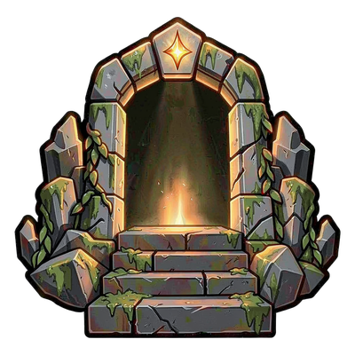

# Page CurseForge

Ce document contient le texte de la page CurseForge de NextStep et la liste des règles à respecter, tirées de la [politique de modération de CurseForge](https://support.curseforge.com/support/solutions/articles/9000197279-moderation-policies).

## Règles de modération à respecter

| Règle CurseForge | Application à NextStep |
|---|---|
| Nom en anglais, sans nom du jeu, de classe ni numéro de version | « NextStep » : conforme. Ne pas écrire « NextStep - WoW Forever ». |
| Résumé : un aperçu court, idéalement une phrase, qui ne répète pas la description | Résumé ci-dessous, formulé autrement que l'accroche de la description. |
| Description : dire ce que l'addon ajoute ou change, avec des informations concrètes | Seules les fonctionnalités **présentes dans le fichier publié** sont décrites ; le reste tient en une ligne « prévu ». |
| Autres langues autorisées, mais **l'anglais d'abord** | Un seul champ de description : anglais en premier, puis français. |
| Avatar 400×400, pas en WebP, ni couleur unie ni image protégée | `img/logo/nextstep-curseforge-400.png` (PNG 400×400, logo original). |
| Images retouchées par IA qui pourraient tromper sur l'addon : mention visible | Le logo n'est pas une capture d'écran ; il est quand même signalé comme généré par IA en bas de page. Les captures de la galerie doivent être de vraies captures en jeu, sans retouche. |
| Liens vers son site, son dépôt, ses dons : **uniquement en bas** de la description | Le lien GitHub n'apparaît que dans la dernière section. Aucun lien de don. |
| Aucun lien de téléchargement externe | Aucun : le fichier est téléchargé sur CurseForge. |
| Contenu réutilisé : sous licence ou avec permission (la permission est recommandée même sous licence), et crédité | Polestar (GPL-3.0-only), pfQuest (MIT), Ding/DingDB (GPL-3.0) et les autres sources sont crédités et liés ; leurs notices sont livrées dans les `LICENSE-DATA.txt` de l'addon. **Contacter l'auteur de Polestar avant la publication** (prévu en phase 11 de la [feuille de route](ROADMAP.md)). |
| Logiciel libre accepté si sa licence est respectée | NextStep est sous GPL-3.0-only, comme Polestar ; texte de la licence inclus dans le paquet (`NextStep/LICENSE.txt`), avec les notices des données (`LICENSE-DATA.txt`). |
| Respect du jeu, de son éditeur et de ses conditions d'utilisation | Aucune automatisation interdite ; mention des marques de Blizzard. |
| Proposer un canal de retour (bugs, idées) | Tickets GitHub et commentaires CurseForge, cités en bas de page. |
| Un changelog pour chaque fichier envoyé | Coller la section de la version tirée de [CHANGELOG.md](../CHANGELOG.md) à chaque envoi. |
| Pas de mises à jour vides ni de renvois pour gagner en visibilité | Ne publier que des versions qui changent quelque chose. |

**À chaque version** : relire la description pour qu'elle décrive toujours le fichier publié (toutes les phases de la feuille de route sont décrites comme disponibles depuis la v1.0). La section du guide décrit le guide complet : la v0.1 (phase 4 de la feuille de route) et ses compléments v0.1.x (phase 4b : carte et minimap, sorts à apprendre, célébration de niveau, niveau des zones, journal). Tant qu'un complément n'est pas publié, sa ligne passe dans « Planned ».

## Résumé (champ « Summary »)

> Leveling guide with detours, arrow and map pins, gear and dungeon advice, professions and many UI helpers, in English and French, all in one addon.

## Description (champ « Description », Markdown)

Copier tout ce qui se trouve entre les deux marques. Mise en page en Markdown pur (pas de HTML) : logo, emoji, citations, tableaux. Le logo est chargé depuis la branche `main` du dépôt. Après le collage, vérifier le rendu dans l'aperçu de CurseForge, et ajouter de vraies captures d'écran en jeu dans la galerie dès la v0.1.

<!-- Début de la description -->

# ✨ NextStep

> **One addon to take your characters from level 1 to the top on WoW Forever.**
>
> Follow the route, take any detour you like, and always know your next step.

🇬🇧 **English** · 🇫🇷 *Version française plus bas*

---

## 🗺️ Leveling guide

**256 guides** ready to go: leveling for both factions and every race, plus class, profession, reputation and collection guides.

- 🎯 **Made for your character**: the route adapts to your **class and level**, and NextStep offers the starting guide of the zone you are in, whatever your race.
- 🧭 **Arrow and map pins**: a navigation arrow that tells you why you are heading somewhere, with every point of the step on the world map and the minimap.
- 🎨 **Quest levels in color**: grey, green, yellow, orange or red, like in the game, so you know when to gain a level first; elite, group and dungeon quests are flagged.
- 🏹 **Class quests**: offered when you reach their level (like the hunter's pet at 10), then back to your route.
- 📜 **Spells to learn**: what your class trainer has for you now and at every coming level, with the cost; the trainer step is ticked once there is nothing new.
- 📖 **Guide journal**: every guide for your character by category, "Choose your path" at the top, progress, details and one click to follow.
- 🔀 **Detours are fine**: follow an off-route quest chain, and the guide catches up on its own when you come back.
- 🚩 **No surprises**: an abandoned quest is flagged instead of sending the guide backwards.
- 💡 **Tips along the way**: when you are ahead of the curve, when quests turn grey, and the next guide offered when you finish one.
- 💾 **Per character**: each character keeps their own progress.

## 🌍 Speaks your language

- Guides in **English and French**.
- 🧠 **Learns as you play**: where a French NPC name is missing, NextStep picks it up from your client as you meet the NPC (target, mouseover, nameplates, dialogue).
- It never runs in combat, sends nothing anywhere, and can be turned off in one click.

## 🛡️ Built to stay out of your way

| | |
|---|---|
| 🔒 **Private** | No data leaves your PC. NextStep talks to no server. |
| 🧩 **Blizzard-friendly** | Enhances the Blizzard UI instead of replacing it, to avoid errors and conflicts with other addons. |
| 🪶 **Lightweight** | Only your faction's data is loaded. |
| ☑️ **Modular** | Every module has its own checkbox in the options. |

## 🗡️ Gear and dungeons

- 📈 **Upgrade hints** in item tooltips, scored for your spec and level ("+12 %").
- 🎁 **Quest rewards**: the one to take is framed, with the reason; never picked for you.
- 🔔 **Upgrade alert** when better gear lands in your bags, one click to equip.
- 🏰 **Dungeons tab**: the quests to pick up before each dungeon, the remaining steps of their quest chains with the giver and zone, and boss loot with the gain for your spec.
- 🧭 **Gear not to miss** in the next five levels, with where it comes from, and the next milestones (spells, class quests, bags, mount).

## ⚒️ Professions

- 📊 Your professions and their skill, the next rank to learn, profession routes to follow, and an **advisor** for the best pairs for your race, class and goal.
- 🌿 **Gathering nodes** recorded as you farm, shown on the minimap and the world map.

## 🧰 Interface helpers

- 🟦 **Square minimap** with mouse wheel zoom, and **one NextStep button** for every NextStep window and the settings of every addon (other addons' minimap buttons hidden).
- 🌿 **Farming radar**: the minimap, large and see-through, around your character.
- 🗺️ **No more fog** on the world map, and **zone levels** shown on it.
- ❤️ **Health and power values** on unit frames and nameplates.
- 🎒 **Bags and bank**: upgrades and junk marked, the bags and bank of all your characters counted in tooltips and viewable from anywhere; **junk sold** automatically.
- 🪟 **Movable Blizzard windows**, positions remembered.
- ⏰ **Clock** with alarms, timers and a stopwatch.

## ⌨️ Getting started

1. Install NextStep and log in.
2. Type **`/ns`** (or `/nextstep`) to open it, or use the NextStep button on the minimap.
3. Fine-tune it under *Options → AddOns → NextStep*.

---
---

# ✨ NextStep (français)

> **Un seul addon pour monter tes personnages du niveau 1 jusqu'au sommet sur WoW Forever.**
>
> Suis la route, fais tous les détours que tu veux, et sache toujours quelle est ta prochaine étape.

## 🗺️ Guide de leveling

**256 guides** prêts à l'emploi : leveling des deux factions et de chaque race, et guides de classe, de métiers, de réputation et de collection.

- 🎯 **Fait pour ton personnage** : la route s'adapte à ta **classe et ton niveau**, et NextStep propose le guide de départ de la zone où tu te trouves, quelle que soit ta race.
- 🧭 **Flèche et points sur la carte** : une flèche de navigation qui dit pourquoi elle t'envoie quelque part, avec tous les points de l'étape sur la carte du monde et la minimap.
- 🎨 **Niveau des quêtes en couleur** : gris, vert, jaune, orange ou rouge, comme dans le jeu, pour savoir quand prendre un niveau avant ; quêtes d'élite, de groupe et de donjon signalées.
- 🏹 **Quêtes de classe** : proposées quand tu atteins leur niveau (comme le familier du chasseur au 10), puis retour à ta route.
- 📜 **Sorts à apprendre** : ce que ton maître de classe a pour toi maintenant et à chaque niveau à venir, avec le prix ; l'étape « maître de classe » se valide quand il n'y a rien de nouveau.
- 📖 **Journal du guide** : tous les guides de ton personnage par catégorie, « Choisis ton chemin » en tête, avancement, détail et un clic pour suivre.
- 🔀 **Les détours ne posent pas de problème** : suis une suite de quêtes hors route, le guide se recale tout seul à ton retour.
- 🚩 **Pas de mauvaise surprise** : une quête abandonnée est signalée, sans faire reculer le guide.
- 💡 **Des conseils en chemin** : quand tu es en avance de niveau, quand les quêtes deviennent grises, et le guide suivant proposé à la fin.
- 💾 **Par personnage** : chaque personnage garde sa propre progression.

## 🌍 En français dans le texte

- Guides en **français et en anglais**.
- 🧠 **Apprend en jouant** : quand le nom français d'un PNJ manque, NextStep le récupère auprès de ton client quand tu le croises (cible, survol, barres de nom, dialogue).
- Jamais en combat, rien n'est envoyé, et ça se désactive d'un clic.

## 🛡️ Conçu pour rester discret

| | |
|---|---|
| 🔒 **Privé** | Aucune donnée ne quitte ton PC. NextStep ne communique avec aucun serveur. |
| 🧩 **Respectueux de Blizzard** | Améliore l'interface Blizzard au lieu de la remplacer, pour éviter les erreurs et les conflits avec d'autres addons. |
| 🪶 **Léger** | Seules les données de ta faction sont chargées. |
| ☑️ **Modulaire** | Chaque module a sa case à cocher dans les options. |

## 🗡️ Équipement et donjons

- 📈 **Gains dans les infobulles**, calculés pour ta spécialisation et ton niveau (« +12 % »).
- 🎁 **Récompenses de quête** : celle à prendre est encadrée, avec la raison ; jamais choisie à ta place.
- 🔔 **Alerte d'amélioration** quand un meilleur objet arrive dans tes sacs, équipé d'un clic.
- 🏰 **Onglet Donjons** : les quêtes à prendre avant chaque donjon, les étapes restantes de leur suite avec le donneur et sa zone, et le butin des boss avec le gain pour ta spécialisation.
- 🧭 **Équipement à ne pas rater** d'ici cinq niveaux, avec sa provenance, et les prochains jalons (sorts, quêtes de classe, sacs, monture).

## ⚒️ Métiers

- 📊 Tes métiers et leur rang, la maîtrise suivante, les routes de métier à suivre, et un **conseiller** des meilleures paires selon ta race, ta classe et ton objectif.
- 🌿 **Points de récolte** enregistrés pendant que tu farmes, affichés sur la minimap et la carte du monde.

## 🧰 Aides pour l'interface

- 🟦 **Minimap carrée** avec zoom à la molette, et **un seul bouton NextStep** pour toutes les fenêtres de NextStep et les paramètres de chaque addon (les boutons des autres addons masqués).
- 🌿 **Radar de récolte** : la minimap, en grand et en transparence, autour de ton personnage.
- 🗺️ **Plus de brouillard** sur la carte du monde, et le **niveau des zones** affiché dessus.
- ❤️ **Valeurs de vie et de ressources** sur les cadres d'unité et les barres de nom.
- 🎒 **Sacs et banque** : améliorations et camelote marquées, sacs et banque de tous tes personnages comptés dans les infobulles et consultables de partout ; **camelote vendue** automatiquement.
- 🪟 **Fenêtres Blizzard déplaçables**, positions retenues.
- ⏰ **Horloge** avec alarmes, minuteurs et chronomètre.

## ⌨️ Pour commencer

1. Installe NextStep et connecte-toi.
2. Tape **`/ns`** (ou `/nextstep`) pour l'ouvrir, ou utilise le bouton NextStep de la minimap.
3. Règle-le dans *Options → AddOns → NextStep*.

---
---

## 🙏 Credits / Crédits

NextStep builds on these open-source projects. Thanks to their authors! / NextStep s'appuie sur ces projets libres. Merci à leurs auteurs !

- **[Polestar](https://github.com/fitzforge/polestar)**: leveling, class and profession guides, translated names and texts / guides, noms et textes traduits *(GPL-3.0-only)*
- **[pfQuest](https://github.com/shagu/pfQuest)** by Shagu, via Polestar: quest, NPC, object and item facts, French names / faits de quêtes, PNJ, objets et items, noms français *(MIT)*
- **[Ding!](https://github.com/moust4ki/DingGuideWoWForever)** and DingDB by Yendi, via Polestar: French names / noms français *(GPL-3.0)*
- **[CMaNGOS classic-db](https://github.com/cmangos/classic-db)**, via Polestar: NPC spawn heights and walk areas, quest objective counts / hauteurs d'apparition et zones de déplacement des PNJ, nombre d'objectifs des quêtes *(GPL-3.0)*
- **[What's Training](https://github.com/fusionpit/WhatsTraining)** by Fusionpit: class trainer spells / sorts des maîtres de classe *(MIT)*
- **[GatherMate2](https://github.com/Nevcairiel/GatherMate2)** by kagaro, Xinhuan and Nevcairiel: idea of the gathering detection / idée de la détection des récoltes *(GPL-2.0-or-later)*
- **[forever-db](https://github.com/fitzforge/polestar/tree/next/forever-db)** (Polestar) and its sources: quests, quest chains and givers for the dungeon tab and the advice mode / quêtes, suites et donneurs pour l'onglet Donjons et le mode conseil *(GPL-3.0)*
- **ForeverLevelingBiS** by Thunder, via Polestar: boss loot, where leveling gear comes from, racial gear traits / butin des boss, provenance de l'équipement, traits raciaux *(MIT)*
- **[wowsims](https://github.com/wowsims)**, via Polestar: stat weights / poids de stats *(MIT)*

🎨 The logo was generated with AI (FLUX.2 [klein], background removed with BiRefNet). / Le logo a été généré par IA (FLUX.2 [klein], détourage avec BiRefNet).

## 💬 Feedback / Retours

🐞 Found a bug or a wrong guide step, or have an idea? **Leave a comment here** or open an issue on GitHub.

🐞 Un bug, une étape incorrecte, une idée ? **Laisse un commentaire ici** ou ouvre un ticket sur GitHub.

📦 Source code, full credits and licence (GPL-3.0-only) / Code source, crédits complets et licence : **[github.com/fccarlier-be/nextstep](https://github.com/fccarlier-be/nextstep)**

---

*World of Warcraft* and *WoW Forever* are trademarks of Blizzard Entertainment. NextStep is a fan project, not affiliated with Blizzard. / *World of Warcraft* et *WoW Forever* sont des marques de Blizzard Entertainment. NextStep est un projet de fans, sans lien avec Blizzard.

<!-- Fin de la description -->
